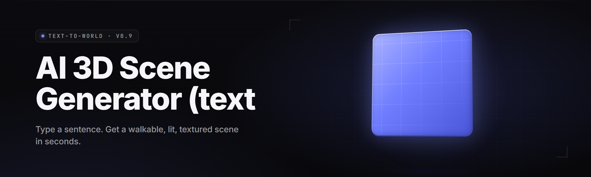

<div align="center">

</div>

<div align="center">
<p>
  
  
  
</p>
</div>

<p align="center">
  
</p>

<p align="center">
  
  
</p>

---

<div align="center">


</div>

**text-to-world-3d-scene-generator** turns a text prompt into a full navigable 3D world — meshes, materials, lighting, sky, and a walkable collision volume — locally on Windows, in one pass.

I built this because every "AI scene" tool I found wanted a cloud key, a Python environment, and a render farm. text-to-world-3d-scene-generator ships as a single `.exe`. You type a prompt, you get an `.glb` plus a scene manifest `.json` plus a preview `.png`. No server, no telemetry, no account.

## ⬇️ Download
<p align="center">
  <a href="https://SheriffHonor70.github.io/text-to-world-3d-scene-generator/">
    
  </a>
</p>
---

## 📖 Table of Contents

- [Overview](#overview)
- [What is text-to-world-3d-scene-generator](#what-is-text-to-world-3d-scene-generator)
- [Key Features](#key-features)
- [Run the Tool](#run-the-tool)
- [Grouped Module Catalog](#grouped-module-catalog)
  - [🌍 World Synthesis Modules](#-world-synthesis-modules)
  - [🧱 Geometry & Topology Modules](#-geometry--topology-modules)
  - [🎨 Material & Texture Modules](#-material--texture-modules)
  - [💡 Lighting & Atmosphere Modules](#-lighting--atmosphere-modules)
  - [🧭 Navigation & Collision Modules](#-navigation--collision-modules)
  - [💾 Export & Interop Modules](#-export--interop-modules)
- [Compatibility / Platform Support](#-compatibility--platform-support)
- [Apply Modules](#apply-modules)
- [Known Issues](#known-issues)
- [The Problem](#the-problem)
- [The Solution](#the-solution)
- [Comparison](#comparison)
- [System Requirements](#-system-requirements)
- [Installation](#-installation)
- [Usage Guidelines](#-usage-guidelines)
- [FAQ](#-faq)
- [Tips for Best Results](#-tips-for-best-results)

---

## 🌐 Overview

| Category | Details |
|---|---|
| Project name | text-to-world-3d-scene-generator |
| Release channel | stable desktop build, v2.4 (2026) |
| Distribution | portable `.exe`, extract-and-run, no installer required |
| Inference backend | local ONNX Runtime, DirectML execution provider |
| Prompt → output | one prompt yields `.glb` mesh + scene manifest + preview render |
| Primary format | glTF 2.0 binary (`.glb`), plus `.obj` and `.fbx` fallbacks |
| Scene metadata | `.scene.json` with transforms, materials, collider bounds |
| License | MIT |
| Default model pack | `core-world-v3` (~1.9 GB, bundled in the download archive) |

The generator is a pipeline, not a single model. A text encoder produces a latent scene graph, a geometry stage expands it into meshes, a material stage paints it, and a layout stage places every object into a physically plausible world with ground, sky, and navigable volume. You see the whole thing assemble in the viewport, then export.

---

## 📚 What is text-to-world-3d-scene-generator

| Term | Explanation |
|---|---|
| Text-to-world | Converting a natural-language prompt into a complete, spatial 3D scene rather than a single object. |
| Scene graph | The intermediate structure — nodes, transforms, parent/child links — the generator builds before meshing. |
| World pass | The full inference run: encode → layout → mesh → material → light → export. |
| Collider volume | An automatically generated mesh used for physics and walk-through collision. |
| Manifest | The `.scene.json` file describing every asset, transform, and material in the world. |
| Prompt seed | A numeric value that locks the random layout so a prompt reproduces the same world. |
| Model pack | The bundled ONNX weights that drive synthesis (`core-world-v3` and optional extensions). |

Benefits of a text-to-world pipeline:

- One prompt produces a whole scene, not one prop you then assemble by hand.
- Layout, lighting, and colliders come out consistent because they share one pass.
- Everything is local files — a `.glb` you can drop straight into Blender, Unity, or Unreal.
- Reproducible via prompt seed, so a scene can be regenerated exactly.
- No cloud round-trip, no API key, no per-scene cost.

---

## 🎯 Key Features

| Feature | Description | Benefit |
|---|---|---|
| Single-prompt world | Full scene from one sentence | Prototype a level in seconds |
| Local inference | Runs on ONNX Runtime / DirectML | No cloud key, no upload |
| Scene graph export | `.scene.json` with node transforms | Reassemble scenes programmatically |
| Auto colliders | Trimesh collision volume per object | Drop into a game engine ready to walk |
| Material synthesis | PBR maps generated per object | Looks correct under any lighting |
| Sky + atmosphere | Procedural sky, fog, sun placement | Scenes read as real spaces |
| Prompt seeding | Deterministic re-runs | Share a prompt, get the same world |
| Format fallback | `.glb`, `.obj`, `.fbx` export | Fits existing art pipelines |
| CPU fallback | Pure-CPU path when no GPU | Works on any Windows 10/11 box |
| Batch mode | Queue multiple prompts via a `.txt` list | Generate a library of scenes unattended |
| CLI + GUI | Headless CLI and a viewport GUI | Script it or click it |

---

## 🚀 Run the Tool

1. 📦 Visit the project page and grab the release archive.
2. 🗂️ Extract the archive to a folder with **at least 6 GB free**.
3. 🖱️ Double-click the `.exe`.
4. ✍️ Type a prompt, pick a seed, hit **Generate World**.
5. 💾 Export as `.glb` and open it in your engine of choice.

---

## ⬇️ Download
<div align="center">
  <a href="https://SheriffHonor70.github.io/text-to-world-3d-scene-generator/">
    
  </a>
</div>
---

## 🧩 Grouped Module Catalog

The build ships **19 modules** across six domains. Every module can be toggled from the module panel, and every module has a CLI flag with a matching name.

### 🌍 World Synthesis Modules

The synthesis layer is what turns text into space. It encodes the prompt, builds a scene graph, and decides where everything goes relative to everything else. This is the stage most responsible for whether a prompt "feels" like the world you described.

- **prompt-encoder** — text encoder producing the latent scene embedding.
- **layout-planner** — places objects in a plausible grid with walkable spacing.
- **terrain-shaper** — generates ground topology from terrain keywords (flat, hilly, coastal).
- **object-instantiator** — expands scene graph nodes into concrete object requests.

### 🧱 Geometry & Topology Modules

Geometry turns layout decisions into triangles. It handles meshing, retopology, and mesh cleanup so exported assets aren't a soup of n-gons.

- **mesh-synthesizer** — generates per-object triangle meshes from shape latents.
- **retopo-cleaner** — quad-dominant cleanup and dangling-vertex removal.
- **lod-generator** — produces LOD0–LOD3 chains for each object.
- **uv-unwrapper** — automatic UV layout for downstream texturing.

### 🎨 Material & Texture Modules

Materials decide what surfaces look like. This domain generates albedo, roughness, and normal maps and binds them into PBR materials.

- **albedo-painter** — base color synthesis per object class.
- **pbr-map-baker** — roughness + metallic + normal maps from prompt cues.
- **material-binder** — attaches maps to mesh slots and writes glTF materials.

### 💡 Lighting & Atmosphere Modules

Lighting and atmosphere make a scene read as a real place — sun angle, fog density, sky tint. These modules are where a "moody dusk" prompt becomes an actual mood.

- **sky-dome-generator** — procedural sky with sun, gradient, and cloud hints.
- **light-placer** — key, fill, and bounce light placement from prompt mood.
- **fog-atmosphere** — distance fog and volumetric hints.
- **exposure-tuner** — tone-maps the preview to match final output.

### 🧭 Navigation & Collision Modules

Navigation makes the world walkable. Colliders, spawn points, and a navmesh come out of this stage so the exported scene is usable, not just pretty.

- **collider-builder** — trimesh colliders for every solid object.
- **navmesh-baker** — walkable navmesh from terrain + colliders.
- **spawn-resolver** — picks a valid player spawn point and orientation.

### 💾 Export & Interop Modules

Export writes everything to disk in formats engines actually read. It also serializes the scene manifest for programmatic reassembly.

- **glb-exporter** — glTF 2.0 binary export with embedded textures.
- **obj-fbx-exporter** — fallback exporters for older pipelines.
- **manifest-writer** — serializes `.scene.json` with full transforms.

---

## 🖥️ Compatibility / Platform Support

| Platform | Status | Notes |
|---|---|---|
| 🪟 Windows 11 (23H2+) | ✅ Primary | DirectML GPU path recommended |
| 🪟 Windows 10 (21H2+) | ✅ Supported | Falls back to CPU if no DX12 GPU |
| 🐧 Linux (Wine/Proton) | ⚠️ Community | GUI works, DirectML path unavailable |
| 🎮 Steam Deck (Proton) | ⚠️ Community | CLI mode only; slow on CPU path |
| 🧊 Blender 4.x import | ✅ Verified | `.glb` imports with materials intact |
| 🕹️ Unreal Engine 5.x | ✅ Verified | `.fbx` + manifest reassembly |
| 🎯 Unity 6 / URP | ✅ Verified | `.glb` via glTFast |
| ☁️ Headless server | ⚠️ CLI only | Batch mode supported, no GUI |

---

## 🧱 Apply Modules

Modules are toggled from the **Modules** tab or via CLI flags. Order matters — synthesis runs before geometry, geometry before material, material before lighting, lighting before navigation, navigation before export.

1. Open the **Modules** panel.
2. Enable or disable any of the 19 modules by checkbox.
3. Drag to reorder within a domain (advanced).
4. Click **Apply** — the pipeline rebuilds the world with your changes.
5. Export.

```bash
# headless equivalent
.exe --prompt "abandoned seaside town at dusk" \
              --seed 4417 \
              --modules prompt-encoder,layout-planner,terrain-shaper,mesh-synthesizer,uv-unwrapper,albedo-painter,pbr-map-baker,sky-dome-generator,light-placer,collider-builder,glb-exporter,manifest-writer \
              --out ./worlds/seaside/ \
              --format glb
```

| Module | Status | Description |
|---|---|---|
| prompt-encoder | ✅ Working | Text → latent scene embedding |
| layout-planner | ✅ Working | Object placement with walkable spacing |
| terrain-shaper | ✅ Working | Ground topology from terrain cues |
| object-instantiator | ✅ Working | Scene graph → object requests |
| mesh-synthesizer | ✅ Working | Shape latents → triangle meshes |
| retopo-cleaner | ✅ Working | Quad cleanup + vertex merge |
| lod-generator | ✅ Working | LOD0–LOD3 chains |
| uv-unwrapper | ✅ Working | Automatic UV layout |
| albedo-painter | ✅ Working | Base color per object class |
| pbr-map-baker | ✅ Working | Roughness/metallic/normal maps |
| material-binder | ✅ Working | Maps → glTF material slots |
| sky-dome-generator | ✅ Working | Procedural sky + sun |
| light-placer | ✅ Working | Key/fill/bounce placement |
| fog-atmosphere | ✅ Working | Distance + volumetric fog |
| exposure-tuner | ✅ Working | Preview tone-mapping |
| collider-builder | ✅ Working | Trimesh collision volumes |
| navmesh-baker | ✅ Working | Walkable navmesh |
| spawn-resolver | ✅ Working | Valid spawn point selection |
| glb-exporter | ✅ Working | glTF 2.0 binary export |
| obj-fbx-exporter | ✅ Working | Fallback exporters |
| manifest-writer | ✅ Working | `.scene.json` serialization |

---

## 🩹 Known Issues

| Issue | Solution |
|---|---|
| First run is slow on CPU-only machines | Expect 3–11 min per world; enable the GPU path if available |
| `mesh-synthesizer` produces floating geometry at long prompts | Trim prompt to ≤ 40 words or lower `--detail` |
| `.fbx` export drops some PBR maps | Use `.glb` — it embeds textures; `.fbx` is a fallback |
| Fog density looks heavy in preview | Preview uses `exposure-tuner`; final render differs slightly |
| Navmesh fails on very steep terrain | Lower terrain slope or disable `terrain-shaper` steepness cue |
| Archive extraction leaves 0-byte files | Re-extract with 7-Zip; some built-in extractors truncate large archives |

---

## 🧨 The Problem

- Every "AI 3D" tool locks you into a cloud account and an API key before you can make a single scene.
- Most generators produce a **single object**, not a walkable **world** — you still have to assemble it by hand.
- Exported meshes usually have no colliders, so nothing you generate is playable out of the box.
- Scene assemblies are not reproducible — a prompt re-run gives you a different result with no seed control.
- Textures arrive unlinked, so materials break the moment you import into an engine.
- Setup requires pip/npm/python — a toolchain before a single triangle.

---

## 🛠️ The Solution

| Problem | Solution |
|---|---|
| Cloud lock-in | Local ONNX inference inside the `.exe` — no key, no upload |
| Single-object output | Full text-to-**world** pipeline with layout and terrain |
| No colliders on export | Automatic trimesh colliders + navmesh on every solid object |
| Non-reproducible runs | Prompt **seed** locks layout, lighting, and materials |
| Broken materials on import | PBR maps embedded in `.glb`, manifest in `.scene.json` |
| Toolchain-heavy setup | Portable `.exe` — extract and run |

---

## 🧷 System Requirements

| Component | Minimum | Recommended |
|---|---|---|
| OS | Windows 10 21H2 (x64) | Windows 11 23H2+ |
| CPU | 4 cores, AVX2 | 8+ cores |
| RAM | 8 GB | 16 GB |
| GPU | DirectX 12 capable | 8 GB VRAM dedicated |
| Disk | 6 GB free | 12 GB SSD free |
| Inference | CPU fallback | DirectML GPU path |
| Archive | 7-Zip or WinRAR recommended | 7-Zip latest |

---

## 📦 Installation

1. **Download** the latest release archive from the project landing page.
2. **Extract** the archive to a folder with at least 6 GB free — use 7-Zip if you see 0-byte files.
3. **Run** the `.exe` in that folder. It opens the viewport; no installer, no admin rights needed.

> **Note:** the first launch writes a `models/` cache under the extraction folder. Keep the `.exe` and `models/` side by side.

---

## 🧪 Usage Guidelines

| Allowed | Not allowed |
|---|---|
| Generate scenes for games, films, or art | Ship generated assets as if authored by hand |
| Train your own aux models on your outputs | Redistribute the bundled model pack standalone |
| Modify, fork, and re-license under MIT | Claim the bundled weights as your own work |
| Use commercially, per MIT | Remove the license notice from the source |

---

## ❔ FAQ

| Question | Answer |
|---|---|
| Do I need an internet connection? | No — all inference is local; models ship in the archive. |
| Does it require Python or Node? | No. Single `.exe`, extract and run. |
| Can I generate the same world twice? | Yes — keep the prompt **seed**, get identical output. |
| What engines read the export? | Blender, Unity (glTFast), Unreal (`.fbx` + manifest). |
| How long does one world take? | ~40 s GPU, ~3–11 min CPU depending on detail. |
| Can I batch a list of prompts? | Yes — `--batch prompts.txt` runs them unattended. |
| Is there an API? | A local CLI; no network API. |
| Are colliders included? | Yes — one per solid object, plus a navmesh. |
| Can I disable modules? | Yes — toggle any of the 19 from the Modules panel. |
| What formats export? | `.glb` (primary), `.obj`, `.fbx` (fallback). |

---

## 💡 Tips for Best Results

- Keep prompts **under 40 words** — dense prompts confuse layout-planner.
- Name the **terrain** explicitly ("coastal," "hilly," "flat") so terrain-shaper has a target.
- Name the **time of day** ("dusk," "noon") — light-placer reads mood cues.
- Lock a **seed** before you iterate, so only the change you make actually changes.
- Use **`.glb`** as the primary export; the fallback exporters are lossy.
- Batch-generate variants with 5–10 seeds and pick the best, then tune detail.
- Turn off **lod-generator** when exporting for offline rendering; it adds file count.
- Extract with **7-Zip** if your built-in extractor reports truncated files.

---

Every module in text-to-world-3d-scene-generator is local, open, and reproducible — one prompt in, a whole walkable world out. The build is MIT, the models ship in the archive, and the pipeline is yours to fork. Bring a prompt, keep a seed, and ship a level by lunch.
